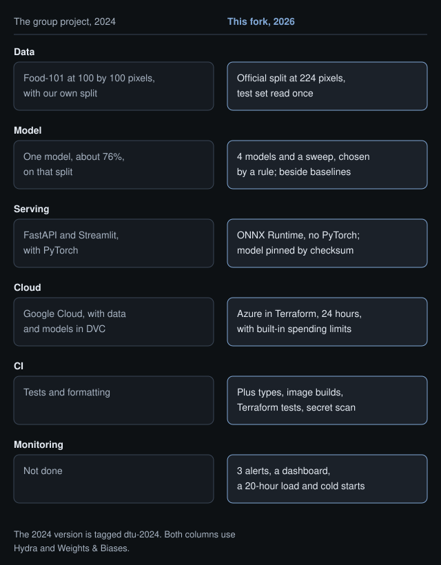
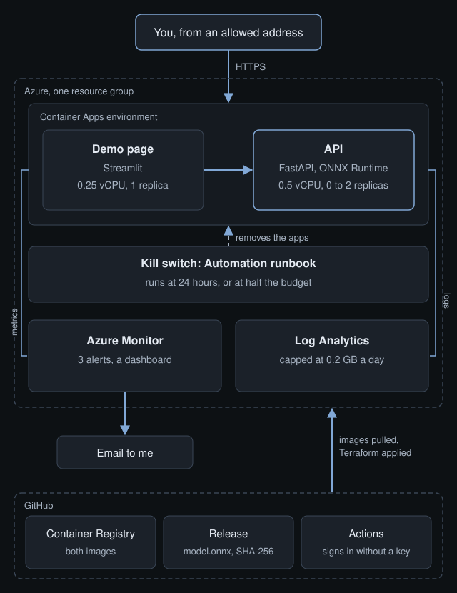
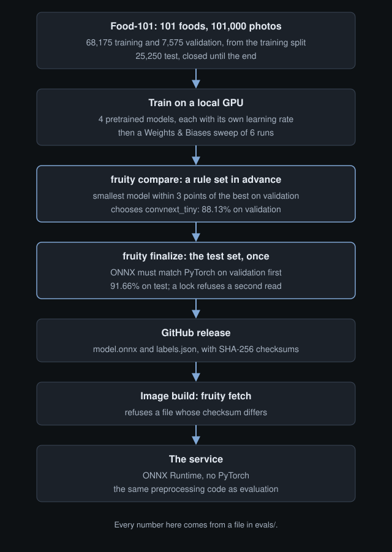
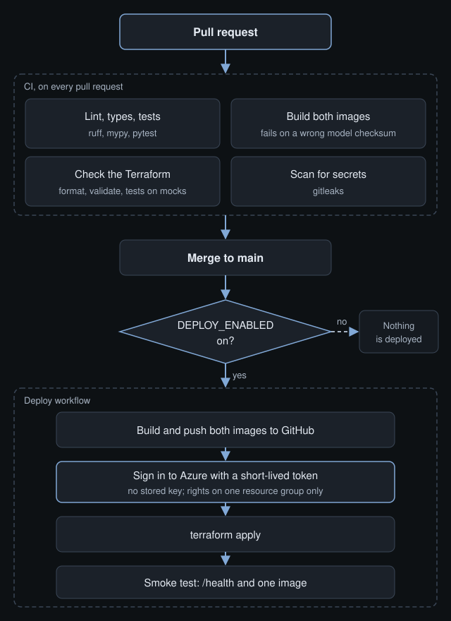
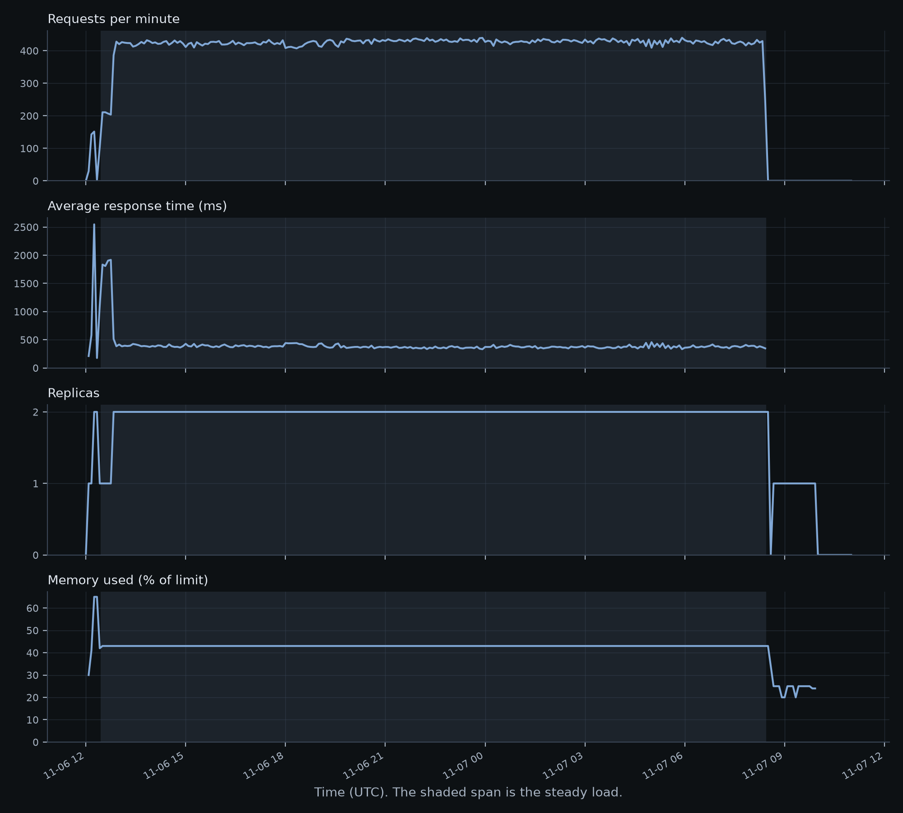
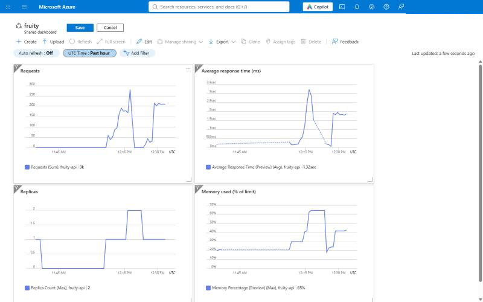
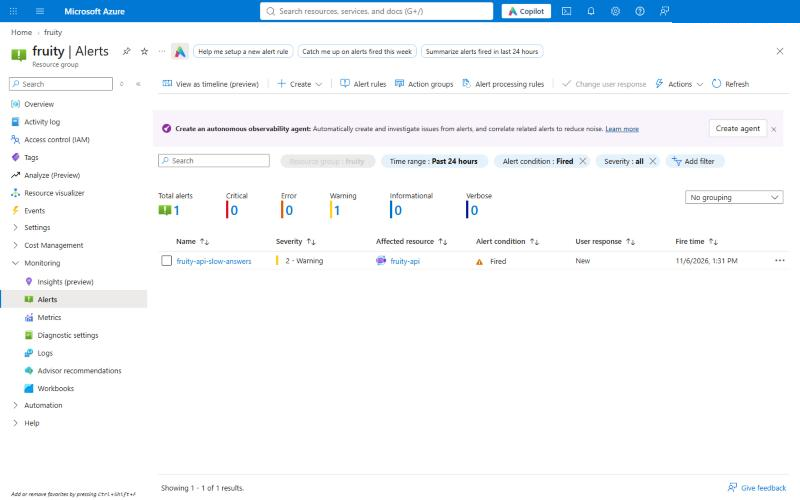
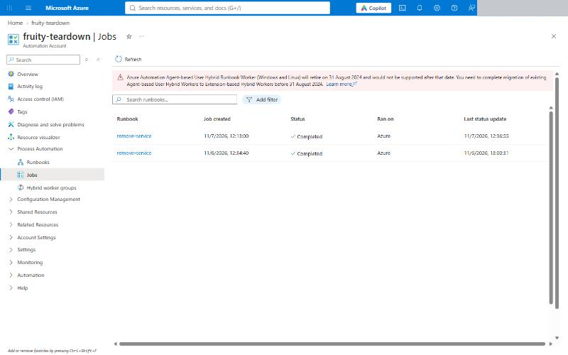
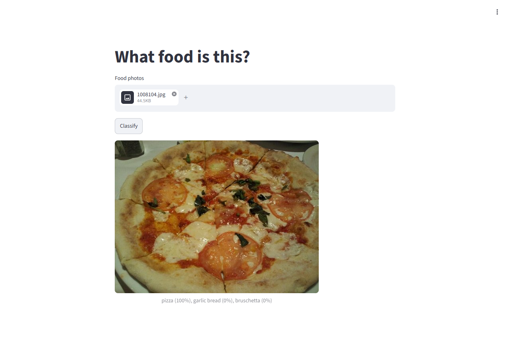

# fruity

A food image classifier that I trained, packaged, ran on Azure for 24 hours and measured. The model is ordinary on purpose: the point is everything around it.

- **91.66%** top-1 on the 25,250 Food-101 test images, read once after every choice was made. Methods without deep learning reach 12.84% here and 50.76% at best in the literature, and guessing gets 0.99%.
- **507,121 requests with 0 failures** in a 20-hour steady load on Azure Container Apps, with the API scaling between 0 and 2 replicas.
- **A cost limit built into the infrastructure**, because Azure has no spending limit for this subscription type: replica caps, a kill switch on a 24-hour timer, an address allowlist and a budget. The timer removed the service on schedule.

This is a fork of [wdmdev/fruity](https://github.com/wdmdev/fruity), my group project for the DTU course 02476 Machine Learning Operations, by William Diedrichsen Marstrand, Karl Byberg Ulbæk, August Semrau Andersen and me. The project as we handed it in is tagged [`dtu-2024`](https://github.com/AndersHenriksen-dev/fruity/tree/dtu-2024). Everything else here I added afterwards.



## Results

| What | Result | Source |
|---|---|---|
| Test accuracy, `convnext_tiny` as ONNX | 91.66% top-1, 98.78% top-5 | [evals/FINAL.md](evals/FINAL.md) |
| Validation accuracy, same model | 88.13% top-1 | [evals/FINAL.md](evals/FINAL.md) |
| Without deep learning, same validation images | 12.84% top-1 | [evals/BASELINES.md](evals/BASELINES.md) |
| Steady load, 10 users for 20 hours | 7.0 requests per second, p95 1,000 ms, 0 failures | [evals/LOAD.md](evals/LOAD.md) |
| One API replica at 0.5 vCPU | about 3 requests per second before requests queue | [evals/LOAD.md](evals/LOAD.md) |
| Cold start, from zero replicas to an answer | median 47.9 seconds | [evals/LOAD.md](evals/LOAD.md) |
| Memory over the steady load | 43% of the limit in the first hour and the last, so no leak | [evals/CLOUD.md](evals/CLOUD.md) |

The model was chosen by a rule committed before any results existed: the smallest model within 3 points of the best on validation. It picked `convnext_tiny` over `convnext_large`, which is 7 times larger for 2 more points. [docs/decisions.md](docs/decisions.md) has the reasons behind this and every other choice.

## How it fits together



The API runs the model on ONNX Runtime, with no PyTorch in its image. With one user on Azure, half of its answers took under 180 ms, and it scales to zero when idle. Everything on Azure is in Terraform, and CI signs in with a short-lived token, so no key is stored in GitHub.





## What Azure showed



The shaded span is the 20-hour steady load. Screenshots from the Azure portal:

| | |
|---|---|
|  |  |
|  |  |

## What it cost

**The final cost is not known yet.** Azure reports some costs days late, and it had not reported the Container Apps usage, the part that ran the compute, when I finished. I will add the real figure when it does.

What is known:

- Everything Azure had reported, from storage, logs, alert rules and the kill switch, came to 0.0009 DKK.
- From the replica history, the apps used about 53% of the monthly free grant for compute and 25% of the free requests. So I expect the compute to cost nothing, but that is an estimate, not a bill.

How the limit works, and what it leaves open, is in [docs/learn/07-controlling-cost.md](docs/learn/07-controlling-cost.md).

## Run it

You need [uv](https://docs.astral.sh/uv/getting-started/installation/), which installs Python 3.12. Docker is needed for the containers.

```bash
uv sync --all-extras
uv run pytest
uv run fruity fetch                  # download the published model and verify its checksum
uv run fruity serve                  # the API on http://127.0.0.1:8000
docker compose up --build            # the API and the demo page, on http://localhost:8501
```

Training needs Food-101 and a GPU: `uv run fruity train experiment=convnext_tiny`. Deploying to Azure, measuring it and taking it down are in [infra/README.md](infra/README.md).

## Learn more

[docs/learn/](docs/learn/README.md) is a study guide to how this works: choosing a model, ONNX, containers, Terraform, CI, cost, monitoring and load testing, with questions to test yourself.

## Limits

- It is a food classifier with 101 classes. Real photos may score below the test set, whose images were reviewed by hand.
- The load test is small, from one machine. It says nothing about much larger traffic.
- The service ran for 24 hours and is not live now. The demo can be brought back with the steps in `infra/README.md`.
- There is no drift detection, so the service would not notice if its inputs changed.

The code is MIT licensed. The model weights were trained on Food-101 and are released with its terms, described in the [release](https://github.com/AndersHenriksen-dev/fruity/releases/tag/model-v1).
