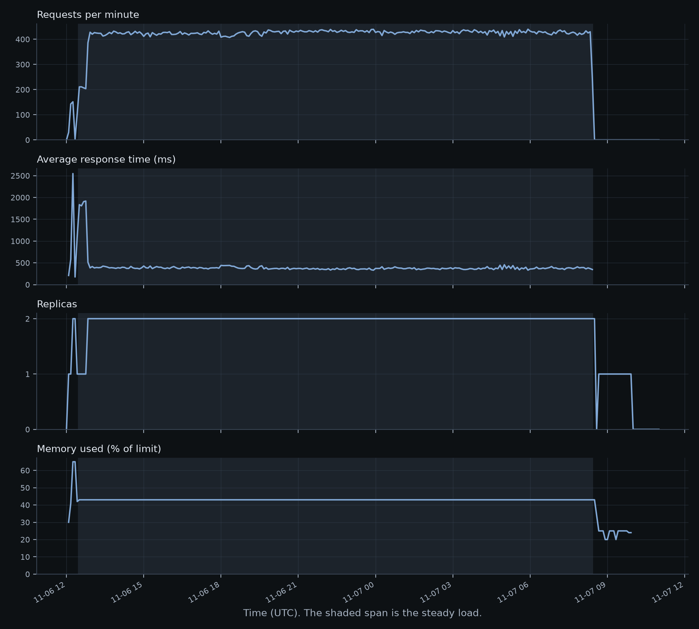

# 8. Monitoring and load testing

## Metrics, logs and alerts

- **Metrics** are numbers over time: requests per minute, memory used. They are cheap and good for spotting that something is wrong.
- **Logs** are records of single events. They are good for finding out why.
- **Alerts** turn a metric into an action, here an email, when it crosses a line.

An alert that never fires might be broken. An alert that fires constantly gets ignored. So each one here maps to something a person would act on, and one gets fired on purpose to prove the path works.

| Alert | Metric | Why |
|---|---|---|
| Server errors | `Requests`, with `statusCodeCategory` of `5xx` | The service is failing. A 4xx is the caller's mistake, so it does not count |
| Slow answers | `ResponseTime` over 1 second | People notice, and it signals overload before errors start |
| High memory | `MemoryPercentage` over 80% | Past the limit, the replica gets killed |

Metric names can be wrong without anything failing: an alert on a name that does not exist may simply never fire. So these were checked against Azure's reference.

## Percentiles, and why averages mislead

If 99 requests take 100 ms and one takes 10 seconds, the average is about 200 ms, which describes nobody's experience. Percentiles are better:

- **p50:** half of requests were faster. The typical experience.
- **p95:** 1 in 20 was slower.
- **p99:** 1 in 100 was slower.

A person making many requests will meet the slow ones often, so the tail is what they remember. p99 needs many requests to be stable, so short stages give rough tails. Azure's `ResponseTime` is an average, so the alert uses that, and Locust's percentiles give the detail.

## What happens as a service fills up

The API can do a fixed amount of work per second, so as users are added:

1. **Under capacity:** latency stays flat and throughput rises with users. Requests rarely wait.
2. **Near capacity:** requests begin to queue. Latency climbs, slowly and then fast.
3. **Over capacity:** the queue grows, latency keeps climbing and throughput stops rising. It can even fall, because time goes on juggling rather than work.

**Little's law** ties this together: users in the system = throughput x time each spends there. With simulated users who wait about a second between requests, this is why adding users past capacity shows up as more latency, not more throughput. It also gives a sanity check on any results table.

The service on Azure showed exactly this. One API replica at 0.5 vCPU topped out at about 3 requests per second: at 5 users p95 was 1.2 seconds, and at 10 users 3.4 seconds, with the same throughput. A second replica only starts when one has more than 10 requests in flight, so 10 users were slow on one replica without triggering a second. At 20 users it did start, and the 20-hour steady load ran on 2 replicas almost throughout, at 7 requests per second with a p95 of 1.0 second. The numbers are in [evals/LOAD.md](../../evals/LOAD.md) and [evals/CLOUD.md](../../evals/CLOUD.md).

## How the load test is designed

- **Each stage is a separate Locust run**, so each row has its own clean statistics.
- **Real photos, sent as real uploads,** because decoding images is part of the work. They come from the training set, so no test image is used.
- **Users wait 0.5 to 1.5 seconds between photos.** Sending as fast as possible measures something no real visitor does.
- **The rate limit has to be raised first.** At the default, most requests get refused, so the test would measure only the limit. It goes back afterwards.
- **It refuses other hosts.** A load test pointed at someone else's service is an attack, so the allowed hosts are in config and checked before any request.
- **Locust runs in its own process.** Importing it patches Python's networking for the whole process, so the code that runs the test must not import it.

## Steady load and cold starts

The **stages** show how far it goes. The **steady load** holds 10 users for 20 hours, which shows what a short test cannot: a slow memory leak, or something that fails after hours. It also gives the dashboard a long, real record.

**Cold starts** are measured separately because they need the opposite: the service must first scale to zero, so each measurement waits about 7 minutes. The time includes pulling the image, starting the process and loading the model. On Azure the median was 47.9 seconds over 10 tries. The same image starts in seconds on a machine that already has it, so most of a cold start is likely fetching the image. A smaller image would cut that, and so would keeping one replica warm, at the cost of paying for idle time.

The steady load also answered the question a short test cannot: memory sat at 43% of the limit in the first hour and in the last, so nothing leaked over 20 hours. The slow answer alert fired twice during the stages and resolved by itself both times.

## What this does not show

- The load comes from one machine, so its network and limits are in the numbers.
- A test of 20 users says nothing about 20,000.
- There is no drift detection, so the service will not notice if its inputs change.

## In this repo

- [infra/monitoring.tf](../../infra/monitoring.tf): the alerts and the dashboard.
- [loadtest/run.py](../../src/fruity/lib/loadtest/run.py): stages, steady load, cold starts and the host check.
- [loadtest/locustfile.py](../../src/fruity/lib/loadtest/locustfile.py): what one simulated user does.
- [config/loadtest/run.yaml](../../src/fruity/config/loadtest/run.yaml): how hard, and at which hosts.
