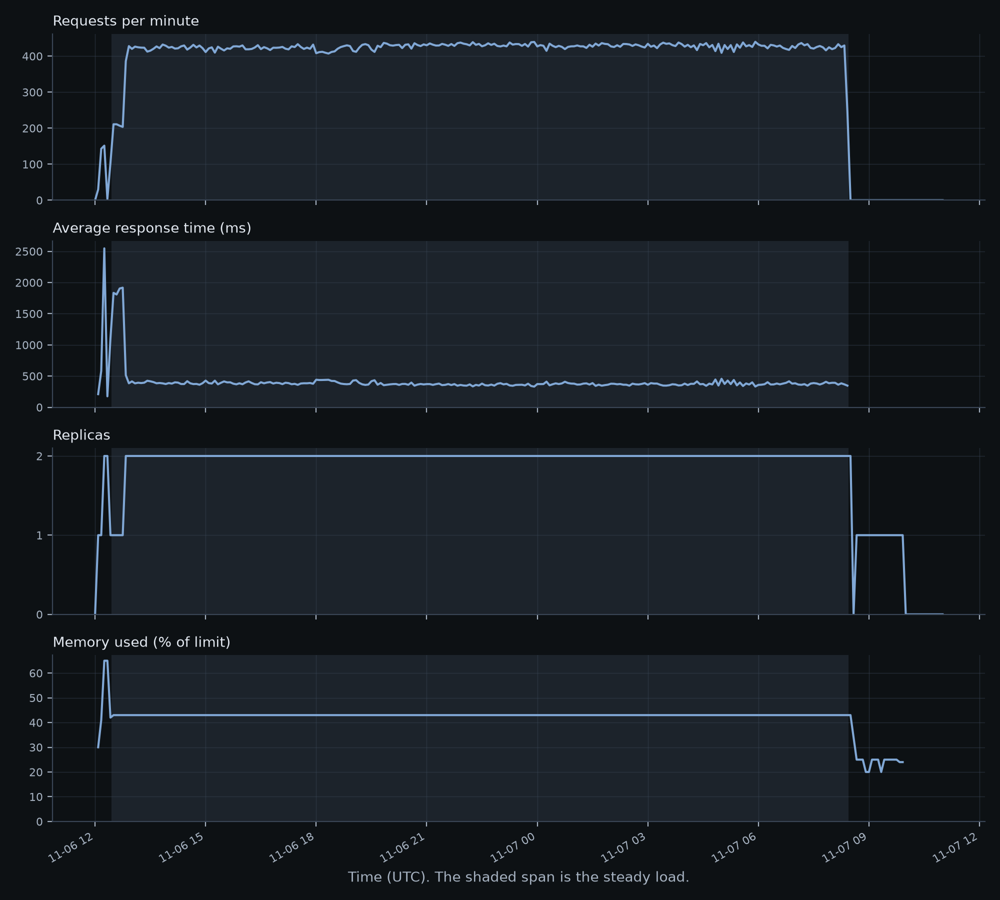

# The service on Azure

Generated by `fruity cloud-report` from `azure_metrics.json` and `azure_alerts.json`, which were saved from Azure while the service ran. Do not edit by hand.

From 2026-11-06 12:00 to 2026-11-07 11:00 UTC, in 277 steps of 5 minutes, Azure counted 508,823 requests to the API. Replica restarts recorded: 0.

## During the steady load

- The API ran 2 replicas in 236 of 240 steps.
- Memory averaged 43% of the limit in the first hour and 43% in the last, with a peak of 43%. A leak would show as a climb.

## Use against the free grant

| What | Used | Free each month | Share |
|---|---:|---:|---:|
| vCPU-seconds | 95,850 | 180,000 | 53% |
| GiB-seconds | 191,700 | 360,000 | 53% |
| Requests | 508,826 | 2,000,000 | 25% |

Worked out from the most replicas seen in each 5-minute step and each replica's size, so it is an upper estimate. It is not a bill: Azure's own figures are what count.

## Alerts that fired

| Alert | Severity | Fired (UTC) | Resolved (UTC) |
|---|---|---|---|
| `fruity-api-slow-answers` | Sev2 | 2026-11-06 12:18 | 2026-11-06 12:28 |
| `fruity-api-slow-answers` | Sev2 | 2026-11-06 12:31 | 2026-11-06 12:56 |

## Limits

- Each point is a 5-minute total or average, so short spikes are smoothed out.
- Azure's response time is an average. The percentiles are in `LOAD.md`.
