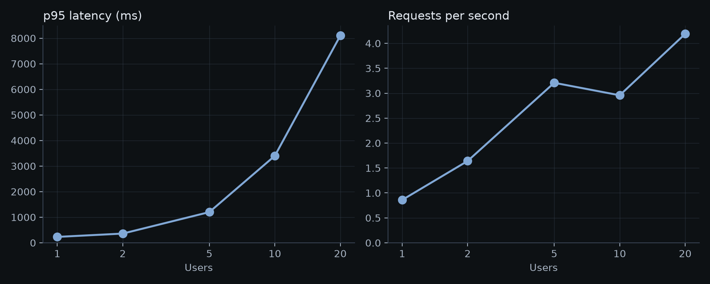

# Load test

Generated by `fruity loadtest` from `load_test.json`. Do not edit by hand.

Target: `fruity-api.salmonbay-9ae4941b.swedencentral.azurecontainerapps.io`. Each simulated user sends a food photo, waits 0.5 to 1.5 seconds and repeats.

## Under load

| Users | Requests | Failures | Requests/s | p50 (ms) | p95 (ms) | p99 (ms) | Most replicas |
|---:|---:|---:|---:|---:|---:|---:|---:|
| 1 | 102 | 0 | 0.9 | 180 | 230 | 270 | 1 |
| 2 | 193 | 0 | 1.6 | 190 | 360 | 480 | 1 |
| 5 | 379 | 0 | 3.2 | 480 | 1200 | 1500 | 1 |
| 10 | 351 | 0 | 3.0 | 2400 | 3400 | 3800 | 1 |
| 20 | 497 | 0 | 4.2 | 3500 | 8100 | 9600 | 2 |

A failure is any answer that is not a success.

## Steady load

10 users for 20.0 hours: 507,121 requests, 0 failures, 7.0 requests per second, p50 300 ms, p95 1000 ms, p99 1500 ms. At most 2 replicas ran.

## Cold starts

From a service scaled to zero to the first answer, 10 times: median 47.9 s, fastest 47.7 s, slowest 58.0 s.

## Limits

- The load came from one machine, so these times include its network and its own limits.
- This is a small test of a small service. It says nothing about much larger traffic.
