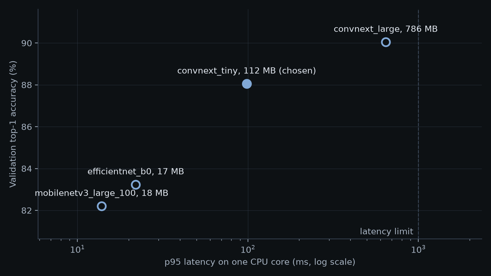

# Results

Generated by `fruity compare` from `evals/comparison.json`. Do not edit by hand.

All accuracy here is on the validation set: 7,575 images held out of the official Food-101 training split.

## Comparison

| Model | Learning rate | Training time | Size (MB) | Top-1 | Top-5 | p50 (ms) | p95 (ms) |
|---|---:|---:|---:|---:|---:|---:|---:|
| `efficientnet_b0` | 0.001 | 13 min | 16.8 | 83.23% | 95.23% | 21 | 22 |
| `mobilenetv3_large_100` | 0.001 | 11 min | 17.5 | 82.20% | 94.71% | 13 | 14 |
| `convnext_tiny` | 0.0001 | 20 min | 111.6 | 88.05% | 97.02% | 91 | 98 |
| `convnext_large` | 0.0001 | 82 min | 785.6 | 90.05% | 97.53% | 594 | 643 |

Latency is one image from file to answer, on one CPU core and one thread, as PyTorch.

## Choice

The best validation top-1 is 90.05%. Models within 3 points of it: `convnext_tiny`, `convnext_large`.
The smallest of these with a p95 at or below 1000 ms is **`convnext_tiny`**, with a p95 of 98 ms.

## The chosen model in each form

| Form | Size (MB) | Top-1 | Top-5 | p50 (ms) | p95 (ms) |
|---|---:|---:|---:|---:|---:|
| PyTorch | 111.6 | 88.05% | 97.02% | 91 | 98 |
| ONNX | 112.1 | 88.05% | 97.02% | 84 | 90 |
| Quantized ONNX | 28.5 | 85.76% | 96.03% | 42 | 46 |

## Its worst classes

| Class | Top-1 |
|---|---:|
| steak | 59.4% |
| pork chop | 71.4% |
| tuna tartare | 73.1% |
| chocolate mousse | 75.0% |
| filet mignon | 77.0% |

## Limits

- Each model was trained once, with one seed, so small gaps between models may be noise.
- Latency comes from one core of a desktop CPU, which may be faster than a vCPU in the cloud.
- Latency also moves between runs on a desktop, so treat it as a rough figure.
- The hand-in's 76% used a custom split and 100x100 images, so it cannot be compared with these numbers.
